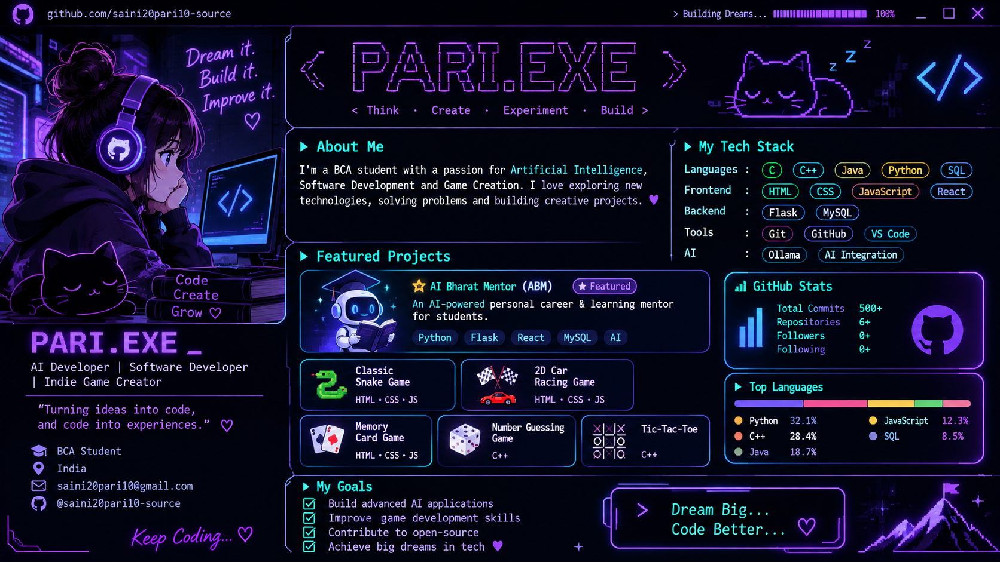



# ⚡ PARI.EXE

### `AI DEVELOPER` · `SOFTWARE DEVELOPER` · `INDIE GAME CREATOR`

**Think. Create. Experiment. Build.**

---

## 👩‍💻 `whoami`

Hi! I'm a BCA student from India passionate about technology, creativity and problem-solving.

I enjoy building AI-powered applications, experimenting with programming languages and creating interactive games.

- 🤖 Building AI-based projects
- 🎮 Exploring game development
- 💻 Learning through practical coding
- 🚀 Turning creative ideas into real applications

## ⚙️ `tech_stack`

**Programming Languages**

**Development Tools & Technologies**

## 🚀 `featured_projects`

### 🤖 AI Bharat Mentor — ABM
An AI-powered personal career and learning mentor designed to help students explore careers, improve skills and prepare for opportunities.

**Tech:** Python · Flask · React · MySQL · AI

### 🎮 Game Development Lab

| Project | Technology | Repository |
|---|---|---|
| 🐍 Classic Snake Game | HTML, CSS, JS | [View](https://github.com/saini20pari10-source/Classic-Snake-Game) |
| 🏎️ 2D Car Racing Game | HTML, CSS, JS | [View](https://github.com/saini20pari10-source/2D-Car-Racing-Game) |
| 🧠 Memory Card Game | HTML, CSS, JS | [View](https://github.com/saini20pari10-source/Memory-Card-Game) |
| 🔢 Number Guessing Game | C++ | [View](https://github.com/saini20pari10-source/Number-Guessing-Game-CPP) |
| ❌ Tic-Tac-Toe | C++ | [Repository](https://github.com/saini20pari10-source/Tic-Tac-Toe-CPP) |

## 📊 `github_analytics`

## 🎯 `next_mission`

- Build more AI-powered applications.
- Explore graphical game development.
- Improve software engineering skills.
- Collaborate on creative projects.
- Contribute to open-source.

---

### 💜 DREAM BIG. CODE BETTER. BUILD FEARLESSLY.

**Thanks for visiting my digital world!**

`PARI.EXE — Always Learning, Always Building.`

