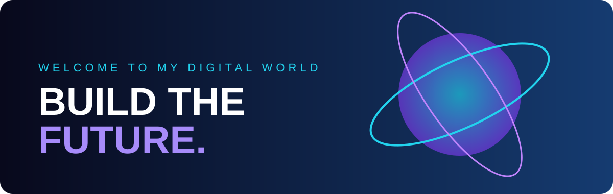



# PARI // DEVELOPER

### AI DEVELOPER · INDIE GAME DEVELOPER

---

## `01 / ABOUT ME`

**BCA Student | Developer | Creative Thinker**

I enjoy exploring technology, building applications and turning creative ideas into real projects.

- Exploring Artificial Intelligence
- Developing indie games
- Learning new technologies
- Building projects independently
- Experimenting with creative solutions

---

## `02 / FEATURED PROJECTS`

<table>
<tr>
<td width="50%" valign="top">

### ◈ AI BHARAT MENTOR

An AI-powered career and learning companion designed to help students explore career paths, improve skills and build confidence.

**Technologies**

`PYTHON` `FLASK` `REACT` `MYSQL` `AI`

</td>
<td width="50%" valign="top">

### ◈ FIVE ELEMENTS

An indie game development project exploring gameplay, mechanics and interactive worlds using Unreal Engine.

**Technologies**

`UNREAL ENGINE 5` `BLUEPRINTS` `GAME DEV`

</td>
</tr>
</table>

---

## `03 / CURRENTLY EXPLORING`

- Artificial Intelligence and AI integrations
- Unreal Engine 5 and game mechanics
- Blueprint-based game development
- Frontend development
- Creative UI design

---

## `04 / GITHUB ANALYTICS`

---

### `DESIGN // DEVELOP // DISCOVER`

**Curiosity is the engine. Creation is the journey.**

